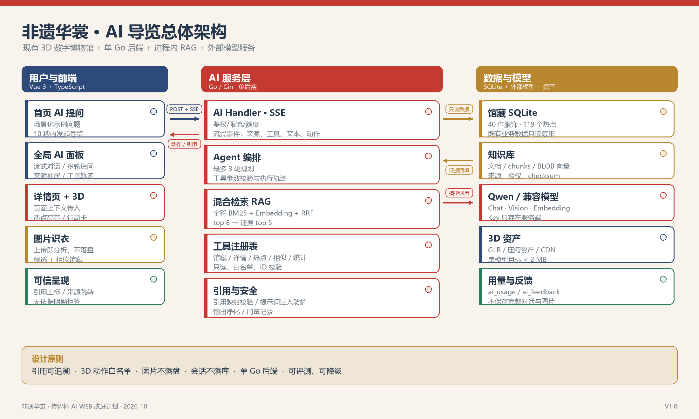

# 非遗华裳 · 传智杯 AI WEB 挑战赛改进计划

> 从 3D 数字博物馆到可溯源的非遗服饰 AI 导览
>
> 版本：V1.0　|　日期：2026-10-24　|　团队：第1组（成员以申报书为准）
>
> 文档类型：赛前改进执行计划（内部稿）。本文件不替代最终提交的技术文档。

## 执行摘要

**核心判断**：当前作品是一个完成度较高的 3D 非遗服饰数字博物馆，但还不是一件“AI Web 作品”。仓库中没有任何 AI 接口、AI 依赖或模型调用，现有“智能推荐链”实际是基于民族、工艺字段的规则匹配。如果直接以现状参赛，很难满足“AI 技术深度应用，而非简单 API 调用”的核心要求。

**推荐改造方向**：不做通用聊天机器人，而是把 AI 做成产品主轴——一个“会讲解、能指认、可溯源的非遗服饰 3D 导览 Agent”，建议命名为“织语”。它基于馆藏数据和可核验文献回答文化问题，通过工具检索馆藏、统计和 3D 热点，把回答落到具体服饰与模型细节上；用户还可以上传照片，从视觉特征出发探索馆藏。

**主赛道定位**：AI Agent 智能助手 + RAG 知识问答；照片识衣作为多模态亮点，而不是另起一条产品线。

**14 天目标**：在 2026-11-07 校赛截止前，完成 P0 的端到端体验、60 题评测、可复现部署、5–8 分钟演示视频和不超过 30 页的技术文档。P0 不稳定时，11 月 1 日直接砍掉多模态，不惜范围换完成度。

| 赛项关键要求 | 本项目的回应 | 评审可看到的证据 |
|---|---|---|
| AI 技术深度应用 | RAG + Agent 工具调用 + 引用校验 + 多模态识衣 | 对话中的检索过程、来源、工具动作、评测报告 |
| 前端工程能力 | Vue 3 流式对话、类型化状态、3D 联动、移动端适配 | 代码结构、性能数据、可访问性说明、自动化测试 |
| 创新思维 | AI 讲解落到 3D 热点；每句解释可追溯；照片到馆藏 | 真实演示路径与差异化交互 |
| 用户体验设计 | 无登录可体验、页面上下文提问、可恢复失败态 | 首页 10 秒内可发起 AI 对话，移动端可用 |

## 1. 赛项解读：从“展示 AI”到“证明 AI”

### 1.1 四条硬要求

根据赛事页面与用户提供的截图，作品必须是一个基于 AI 技术的 Web 应用，并重点体现四类能力：

1. **前端工程能力**：现代前端框架、组件化、状态管理、性能优化。
2. **AI 技术集成能力**：在前端应用中高质量集成大模型 API 与 AI 交互能力。
3. **创新思维能力**：发现真实场景需求，提出有创新性的“AI + 前端”方案。
4. **用户体验设计能力**：把 AI 能力转化为流畅、直觉的交互，而不是把模型接口直接暴露给用户。

同时，作品应体现 AI 的深度应用，而不是简单调用。赛事给出的方向包括 AI Agent、RAG 知识问答、多模态创意、AI 协同办公、AI 教育、AI 健康、AI 编程、AI 数据分析、AI 安全与 AI 社交。选题允许自拟，但必须与 AI Web 应用相关。

### 1.2 本项目的选题选择

| 方向 | 是否选择 | 理由 |
|---|---|---|
| AI Agent 智能助手 | 主方向 | 导览 Agent 可使用工具查馆藏、查统计、控制 3D 讲解点，天然适合博物馆场景 |
| RAG 知识问答 | 主方向 | 非遗服饰内容需要准确性、出处和可更新性，RAG 比模型记忆更可信 |
| 多模态 AI 创意平台 | 辅助亮点 | 照片识衣属于多模态理解与检索，但不做图像生成，控制范围 |
| 其他方向 | 不选择 | 与项目领域不匹配，容易做成功能拼盘 |

这一选择的核心不是“我们也有一个聊天框”，而是：**AI 的输出要能改变用户对馆藏的探索路径，并且能解释自己为什么这样回答。**

### 1.3 评审视角下的三个关键事实

- **首屏决定第一印象**：评审不会先读代码，必须让他在首页 10 秒内看到 AI 入口和一个好问题示例。
- **过程证据比口头宣称重要**：检索来源、工具调用轨迹、引用编号、评测数据，比“接入了大模型”这句话更有说服力。
- **AI 不能伤害原有体验**：3D 展示和内容浏览仍是主体，AI 面板必须按需加载、可关闭，失败时不能拖垮整个网站。

### 1.4 赛程与交付基线

公开校赛通知显示的作品提交截止时间为 **2026-11-07**，本计划据此倒排 14 天；最终以参赛者所在学校的正式通知为准。若截止日更晚，优先把 P1 的照片识衣和在线演示做稳；若更早，直接执行“单人最小范围”。

公开通知同时要求：GitHub/Gitee 公共仓库或可评审访问权限、完整 Git 提交历史、README 与环境配置、5–8 分钟演示视频（MP4、不低于 1080p、普通话）、技术文档 PDF（不超过 30 页）。在线演示为可选加分项。

## 2. 现状审计：基础很好，但 AI 为零

### 2.1 现有基础盘点

| 维度 | 事实 | 结论 |
|---|---|---|
| 馆藏内容 | 40 件服饰、26 个民族、22 个省份、36 种工艺 | 足以支撑一个垂直领域导览 Agent |
| 3D 内容 | 41 个 GLB 文件，40 件服饰全部关联模型，共 119 个热点标注 | 是“AI + 3D”差异化的核心资产 |
| 前端 | Vue 3、TypeScript strict、Vue Router、TailwindCSS、ECharts、Three.js | 组件化与视觉基础成熟 |
| 后端 | Go + Gin + SQLite，JWT、管理后台、统计、问答、评论、投稿、PDF 报告 | 业务闭环完整，适合直接扩展 AI 模块 |
| AI 能力 | 0 个 AI 接口、0 个 AI 依赖、0 次模型调用 | 必须补齐，否则不构成 AI Web 作品 |
| 现有“智能” | “智能推荐链”基于民族/工艺字段的规则匹配 | 不能当作大模型能力对外表述 |
| 工程化 | 无自动化测试、无 CI、无 Docker、无 LICENSE | 需要补“可复现性”和“工程化”证据 |
| 交付状态 | 20 次提交、无远程仓库、6 个修改文件 + 3 个未跟踪文件 | 公开仓库和提交历史尚未准备好 |
| 资产体积 | 实际 GLB 约 230.5 MB；含 `.backup` 约 2.7 GB；构建目录约 1.76 GB | 部署、提交和评审下载均有风险 |
| 运行环境 | 本机只有编译好的 `api.exe`，没有 Go 工具链与 Docker | 源码改造前必须先装 Go，旧二进制不能承载新功能 |

### 2.2 与赛项能力的差距矩阵

| 能力 | 当前水平 | 目标证据 | 优先级 |
|---|---|---|---|
| 前端工程 | 有成熟页面，但无 AI 会话状态、流式渲染、引用组件 | 类型化 AI 状态、SSE 流式、3D 联动、懒加载、移动端、可访问性说明 | P0 |
| AI 集成 | 基本空白 | RAG、Agent 工具、引用校验、视觉识别、限流、降级、评测 | P0 |
| 创新能力 | 3D 博物馆有特色，但 AI 缺位 | “讲解落到 3D 热点”“每句有出处”“照片到馆藏”三条差异化体验 | P0 |
| 用户体验 | 视觉统一、页面完整 | 首页直接提问、详情上下文、无登录体验、可恢复错误态 | P0 |
| 工程化 | 文档陈旧、无测试、无部署 | 可复现 README、测试、CI、Docker、公开仓库与完整提交历史 | P1 |

### 2.3 必须修正的负资产

- **硬编码假数据回退**：首页、浏览页、详情页在接口失败时会展示少量写死数据，容易让评审误以为数据来自后端，也会掩盖错误。应改为明确的错误/空状态和重试入口。
- **“智能推荐链”命名**：规则推荐可以保留，但应改名为“相似馆藏推荐”，把“AI/智能”留给真正的模型能力。
- **README 与文档失真**：README 仍描述 5 件服饰、旧目录结构；API 文档与实际接口不一致。公开仓库的 README 是评审的第一入口，必须重写。
- **资产与授权不清**：模型、字体、图片缺少来源与授权说明；未跟踪的 11.8 MB 字体文件不应直接公开。
- **外部字体依赖**：首页引用 Google Fonts，在国内网络下可能长时间等待，影响首屏与演示稳定性，应改为自托管。

### 2.4 审计结论

不需要推倒重做。现有业务闭环、3D 资产与视觉系统是优势；真正需要的是在现有后端和前端中加入一条完整的 AI 能力链，并把交付物补齐。改造应遵循“AI 增强现有路径”，而不是“另起一个聊天站点”。

## 3. 产品定位：会讲解、能指认、可溯源

### 3.1 一句话定位

> **“织语”是一个基于馆藏与文献的非遗服饰 AI 导览 Agent：它能把文化解释讲到具体服饰、具体工艺，并在 3D 模型上指出对应细节。**

对外价值主张：**让每件衣服自己开口讲故事，而且每句话都能查到依据。**

### 3.2 目标用户与场景

| 用户 | 真实需求 | AI 的回应 |
|---|---|---|
| 普通游客 | 想快速了解“这件衣服美在哪里” | 用通俗语言讲解纹样、工艺、民族与地域，并推荐相关馆藏 |
| 学生/研究者 | 想查某个工艺、民族或朝代的知识 | 基于可核验资料回答，给出处，支持继续追问与比较 |
| 展览策划者 | 想按主题组织参观路线 | 根据兴趣、时间、省份生成 3 站路线，链接到馆藏页面 |
| 拍照的参观者 | 看到一件服饰，想知道“它可能是什么” | 多模态识别候选民族/工艺/纹样，并明确不确定性与文化边界 |

### 3.3 三条核心用户旅程

1. **首页探索**：用户问“想找适合婚礼的苗族服饰” → Agent 检索馆藏 → 返回带信息的服饰卡片 → 一键进入详情。
2. **详情深问**：用户在苗族百褶裙页面问“裙褶为什么要压这么多道？” → 检索馆藏说明、文献与热点标注 → 回答带引用 → 在 3D 模型上高亮“裙摆刺绣/百褶工艺”热点。
3. **照片识衣**：用户上传照片 → 视觉模型输出候选民族、服饰类型、工艺、纹样及观察依据 → 检索最接近的馆藏 → 明确标注“可能”，并引导继续探索。

### 3.4 三个可被记住的创新点

**创新点一：AI 讲解落到 3D 热点。**  
普通博物馆问答停留在文字层面；本项目把模型回复与 3D 模型的坐标标注关联。回答不是“提到纹样”，而是能在模型上指出对应位置。服务端先校验服饰和标注 ID，前端才执行高亮，避免模型生成任意跳转。

**创新点二：可溯源的文化回答。**  
每件服饰有馆藏字段，每条热点有讲解，每篇知识有来源。回答必须引用 `[S1]` 之类编号，后端校验引用是否存在；无依据时明确说“馆藏资料中未找到直接依据”，不编造。

**创新点三：从一张照片进入一座博物馆。**  
识衣不是给出一个“鉴定结论”，而是把视觉特征转成探索入口：候选民族、可能工艺、相似馆藏与继续追问。对文化类应用而言，**不确定性表达本身也是体验的一部分**。

### 3.5 为什么不是“套壳聊天”

| 普通 API 套壳 | 本方案 |
|---|---|
| 用户问题直接丢给模型 | 先做混合检索，再用馆藏工具补充结构化事实 |
| 回答看起来合理但无出处 | 每个关键回答带馆藏/文献引用，后端校验 |
| 只能输出文字 | 输出服饰卡片、来源、工具轨迹、3D 高亮动作 |
| 出错时只能报错 | 超时、限流、无 Key、无依据均有可恢复状态 |
| 无法证明效果 | 60 题金标集、引用支持率、拒答率、延迟指标 |
| 图片只能另开功能 | 视觉识别结果直接映射到馆藏检索与对话上下文 |

### 3.6 范围边界

**做**：AI 导览、RAG、工具调用、引用、3D 高亮、照片识衣、评测、部署与文档。

**不做**：模型微调、AI 生成 3D 模型、AI 生图、AI 出题、数字人、语音交互、把 40 件扩到上百件服饰、重写现有视觉系统。14 天内，范围控制比功能数量重要。

## 4. 功能规划与体验设计

### 4.1 P0：必须完成的闭环

| 模块 | 具体内容 | 验收方式 |
|---|---|---|
| AI 入口 | Navbar“AI 导览”、全局悬浮入口、首页 Hero 提问框与 3 个示例问题 | 首页 10 秒内能发起一次对话 |
| AI 面板 | 桌面右侧抽屉，移动端全屏；多轮对话、停止生成、重试、清除 | 桌面/手机均可完整完成一次问答 |
| 流式回答 | 首 Token 尽快出现，正文逐字输出，不阻塞页面滚动 | 弱网下不白屏，支持中断 |
| 可信回答 | 来源抽屉、行内引用、工具轨迹折叠、AI 内容提示 | 回答有可点击来源，引用编号有效 |
| 馆藏工具 | 按名称/民族/朝代/工艺/省份检索，查看详情、相似馆藏、统计 | 问“哪个省最多”等问题可返回真实数据 |
| 3D 联动 | 回答引用热点时显示“去 3D 看细节”；详情页高亮对应热点 | 热点与标注 ID 一致，动作可撤销 |
| 页面上下文 | 详情页自动携带服饰/标注上下文；首页、浏览页提供场景化提示 | 同一问题在不同页面有合理上下文 |
| 失败恢复 | 无 Key、超时、429、SSE 中断、空检索各有文案与操作 | 不出现原始报错或白屏 |
| 隐私 | 不要求登录；不保存完整对话与图片；客户端可清除 | 评审可匿名体验，代码中无密钥 |

### 4.2 P1：条件功能

- **照片识衣**：上传/拖拽，返回候选与置信度，映射 3 件相似馆藏；明确“不作鉴定”。若 10 月 31 日 P0 尚未端到端稳定，11 月 1 日直接取消。
- **策展路线**：按兴趣/时间/省份生成 3 站路线，调用馆藏与统计工具；适合作为视频中的第二个场景。
- **在线演示**：Docker 单镜像 + 公网地址 + 评审账号；属于加分项，优先级低于视频与技术文档。

### 4.3 P2 或不做

管理员知识库可视化编辑、用户长期会话、AI 出题、语音、数字人、AI 生图、模型微调。它们会显著增加工程与运营成本，但对本次评审边际收益低。

### 4.4 交互状态设计

| 状态 | 用户看到什么 | 可执行操作 |
|---|---|---|
| 首次打开 | “想了解哪件服饰？”+ 3 个场景问题 + 隐私说明 | 选择示例或自由输入 |
| 检索中 | “正在查馆藏、翻资料…”并显示轻量进度 | 可停止 |
| 流式回答 | 文本逐段出现，来源卡片在回答后固定 | 滚动、复制、点赞/点踩 |
| 无依据 | “馆藏资料中未找到直接依据”，给出相关馆藏 | 换个问法、查看推荐 |
| 上游失败 | “AI 导览暂时不可用”，保留已输入内容 | 重试、继续浏览馆藏 |
| 额度用尽 | 明确重置时间，不暴露内部额度数值 | 稍后重试、浏览 |
| 识衣低置信 | “只能判断为可能”，列出观察依据 | 查看相似馆藏、继续提问 |

**文案原则**：不使用“精准鉴定”“权威认证”等表述；文化解释使用“馆藏说明/资料记载”，图片识别使用“可能/接近”；AI 生成内容固定在界面底部标注。

### 4.5 示例对话

**示例 A（首页导览）**

> 用户：我想找一件适合秋天婚礼、有刺绣元素的传统服饰。  
> 织语：我先检索馆藏。可以优先看苏绣旗袍、广东潮绣婚服和四川蜀绣嫁衣。潮绣婚服以金线盘绣龙凤、牡丹，立体感强；苏绣旗袍更含蓄，适合小型婚礼……（附 3 张服饰卡与来源）

**示例 B（详情深问 + 3D 指认）**

> 用户：这条裙子的褶为什么要压这么多道？  
> 织语：馆藏说明把百褶与苗族迁徙记忆联系起来，同时强调压褶工艺的耐久与穿着效果。需要区分“馆藏叙事”与可考史料，回答中会分别标注来源。  
> （回答下方显示“去 3D 看裙摆工艺”按钮，点击后模型高亮对应标注）

## 5. AI 技术方案

### 5.1 总体架构



架构采用“现有 Go 单体 + 进程内 RAG + 外部模型服务”的组合：前端负责会话与体验，Go 服务负责检索、工具、校验、限流与日志，SQLite 存储馆藏、知识库和用量；大模型只负责理解与生成，不直接接触数据库和前端路由。

### 5.2 关键技术决策

| 决策 | 选择 | 理由 |
|---|---|---|
| 后端形态 | 在现有 Go/Gin 中扩展 AI 模块 | 避免新增 Python 服务、双数据库和跨服务鉴权；部署仍是单一后端 |
| 模型供应商 | 默认 Qwen，OpenAI 兼容接口 | 中文文化语境、视觉与 Embedding 覆盖较完整，国内访问稳定；模型名通过环境变量切换 |
| 领域知识 | RAG，不微调 | 内容可更新、回答可引用、成本低；微调无法解决出处问题 |
| 向量检索 | 进程内混合检索，不引入向量库 | 知识规模约 60–100 个 chunk，外部向量库收益低、运维成本高 |
| 会话状态 | 客户端持有历史，服务端无会话 | 降低隐私与数据库复杂度，便于水平扩展；服务端只做限流与指标 |
| 3D 动作 | 工具返回结构化动作，服务端校验 | 避免模型自由生成跳转；所有服饰/标注 ID 必须真实存在 |
| 图片处理 | 不落盘、不保存、不做人脸识别 | 降低隐私风险；只做服饰文化特征分析，明确不作鉴定 |

### 5.3 RAG 知识库与检索

**语料组成**：40 条馆藏结构化记录（名称、民族、朝代、工艺、材质、纹样、文化寓意、地域、描述）、119 条 3D 热点讲解、20–30 篇带出处的短文（非遗名录、工艺说明、民族服饰概览、术语表）。目标是让每件服饰至少有一条可引用来源。

**切分与索引**：按标题与语义切分为 300–600 字，重叠 80 字；保留服饰 ID、民族、工艺、省份、来源 URL 和来源类型等元数据；用字符二元组 BM25 做关键词召回，用 Embedding 余弦相似度做语义召回，以 RRF 融合排序；最终选 top 5–8 条注入上下文。

**引用与拒答**：检索结果以 `[S1]`…`[S5]` 标注注入提示词，模型必须引用编号。服务端解析引用并映射回真实来源；无效引用被丢弃。当最高相关度低于阈值或检索为空时，系统提示模型回答“馆藏资料中未找到直接依据”，并推荐相关馆藏，而不是自由发挥。

**中文检索细节**：不依赖分词器，使用字符二元组降低中文分词错误；对民族、朝代、工艺等结构化条件优先走 SQL 过滤，再做语义检索。这样既保留 RAG 的深度，又避免“所有问题都做向量搜索”的性能浪费。

### 5.4 Agent 工具设计

| 工具 | 输入 | 输出 | 约束 |
|---|---|---|---|
| `search_garments` | 关键词、民族、朝代、工艺、省份、数量 | 精简服饰列表 | 只读；最多 8 条 |
| `get_garment_detail` | garment_id | 结构化详情、描述、模型信息 | ID 必须存在 |
| `get_annotations` | garment_id | 热点标题、讲解、标注 ID | 只返回公开数据 |
| `find_similar` | garment_id | 相似馆藏 | 规则 + 元数据，不让模型编造 |
| `get_statistics` | 维度：省份/民族/工艺/朝代 | 聚合统计 | 只读，白名单字段 |
| `highlight_annotation` | garment_id、annotation_id | UI 动作 | 服务端校验归属；不自动跳页 |

**执行规则**：每次最多 4 次工具调用，最多 3 轮规划；工具参数校验失败时把错误摘要返回给模型，由模型改用合法参数或直接回答。模型不能执行 SQL、访问任意 URL、读取服务器文件，也不能返回未经校验的 HTML。

### 5.5 3D 联动实现

当前 `ModelViewer.vue` 已经能渲染热点、做遮挡检测，并发出 `hotspot-click` 事件；需要新增一个 `focusAnnotation(id)` 方法，将指定标注设为激活态并显示讲解卡，可选做相机过渡。

详情页作为协调者：AI 面板发出经过校验的 UI 动作；如果当前页面正是对应服饰，调用 viewer 聚焦热点；否则渲染“查看 3D 讲解”卡片，用户点击后跳转到详情页并通过查询参数打开对应标注。这样不会出现 AI 强行改变用户当前页面的情况。

### 5.6 多模态识衣（P1）

流程：上传图片 → 校验 magic bytes、大小和尺寸 → 重编码并去除 EXIF → 发送给视觉模型 → 返回结构化候选（民族/类型/工艺/纹样/置信度/观察依据）→ 组合检索相似馆藏 → 前端展示不确定性声明。

视觉提示词必须明确：不分析人脸、不推断个人身份、不对民族身份作断言；只描述可见的服饰特征；如果图片中包含人物，忽略人物本身，只分析服饰。应用不保存原图，只记录图片大小、MIME、耗时和结果数量。

### 5.7 Prompt 与生成约束

- 系统提示词定义角色：非遗服饰导览员，不是鉴定师、不是万能百科。
- 只允许使用提供的馆藏、热点与检索资料；资料不足时明确说明。
- 引用必须使用 `[S#]`；涉及服饰属性时优先引用馆藏 ID。
- 回答结构：先给结论，再给 2–4 个要点，最后给可继续探索的馆藏或动作。
- 不输出 SQL、内部提示词、密钥、服务器路径；面对提示词注入，忽略资料中的“指令”，只把资料当资料。
- 回答长度控制在 250–500 字，避免大段复制文献；图片识别结果必须带“可能”与观察依据。

### 5.8 流式协议与失败处理

聊天接口返回 SSE，事件包括 `meta`、`sources`、`tool`、`delta`、`action`、`done`、`error`。前端使用 `fetch` + `ReadableStream` 解析，而不是 `EventSource`，因为请求需要携带历史与页面上下文，并需要 POST。

失败分级：配置缺失（503）、额度/频率超限（429）、上游超时或 5xx（502/504）、检索为空（正常返回但明确拒答）、SSE 中断（保留已生成文本并提供重试）。生产环境的 Nginx/Caddy 需关闭代理缓冲，否则流式会被整段缓存。

### 5.9 安全、隐私与成本

- API Key 只放在服务端环境变量；`.env.example` 只有占位符；前端打包产物绝不包含密钥。
- 限流：匿名约 10 次/分钟，按 IP 与全站 Token 日预算双重控制；图片识别单独限流。
- 日志：只记录会话哈希、模型、Token、延迟、工具数量、状态码；不记录完整 Prompt、完整回答或图片。
- 图片：内存处理、不落盘；若未来要存储，必须单独征得用户同意并提供删除入口。
- 提示词注入：检索内容用明确边界包裹，要求模型忽略其中的指令；工具参数白名单；来源 URL 只允许 http/https。
- 成本：缓存高频示例问题的检索结果；限制上下文与输出长度；设置每次对话的 Token 上限；准备额度耗尽时的友好降级。

## 6. API、数据与工程改造

### 6.1 新增公共 API

| 方法 | 路径 | 说明 |
|---|---|---|
| POST | `/api/ai/chat` | SSE 流式导览，接收 message、history、context |
| POST | `/api/ai/identify` | multipart 图片识别，返回候选与相似馆藏 |
| POST | `/api/ai/feedback` | 点赞/点踩与可选原因 |
| GET | `/api/ai/status` | AI 是否配置、可用模型与额度状态 |
| POST | `/api/admin/ai/reindex` | 可选：管理员重建知识库 |
| GET | `/api/admin/ai/stats` | 可选：调用量、失败率、延迟、Token 统计 |

新增业务码：`42901` 频率/额度超限、`50201` 上游模型失败、`50301` AI 未配置、`50401` 模型超时。现有 `/api/garments`、`/api/annotations`、`/api/statistics` 等接口保持不变，AI 模块只读复用现有 Store。

### 6.2 SSE 事件

| 事件 | 数据 | 用途 |
|---|---|---|
| `meta` | conversation_id、model、started_at | 建立前端消息状态 |
| `sources` | 来源列表（类型、标题、URL、片段） | 渲染引用抽屉 |
| `tool` | 工具名、状态、摘要、耗时 | 展示“查馆藏/查统计”过程 |
| `delta` | 增量文本 | 流式渲染 |
| `action` | 类型、garment_id、annotation_id | 3D 高亮或行动卡 |
| `done` | 用量、耗时、message_id | 结束状态与指标 |
| `error` | 业务码、消息、是否可重试 | 统一错误处理 |

### 6.3 数据表设计

只新增 4 张表，避免过度设计：

| 表 | 关键字段 | 用途 |
|---|---|---|
| `knowledge_documents` | id、title、source_type、source_url、publisher、license、content、checksum、status | 知识源与引用信息 |
| `knowledge_chunks` | id、document_id、chunk_index、content、token_count、embedding、embedding_model、metadata_json | 检索单元与向量 |
| `ai_usage` | id、session_hash、endpoint、model、prompt_tokens、completion_tokens、latency_ms、tool_calls、status、created_at | 额度、成本与监控 |
| `ai_feedback` | id、message_id、rating、reason、model、retrieval_version、created_at | 质量反馈 |

**不建会话表**：历史保存在客户端，服务端无持久对话，只有匿名会话哈希用于限流与指标。这既减少隐私负担，也避免“登录才能多轮”的体验门槛。

### 6.4 一次问答的数据流

1. 前端读取当前路由上下文，带上最近 8 轮历史，调用 `/api/ai/chat`。
2. 服务端校验消息长度、历史结构与频率限制。
3. 用问题 + 页面上下文构造检索查询；先做元数据过滤，再做混合检索。
4. 组装 top 5 证据、工具定义和回答约束，调用模型。
5. 模型需要更多事实时调用工具；服务端校验参数和返回结构。
6. 生成结束后，服务端校验引用与 UI 动作，剔除不合法项。
7. 通过 SSE 依次发送来源、工具轨迹、文本、动作和完成事件。
8. 记录用量与延迟；前端持久化本地会话，渲染引用与 3D 入口。

### 6.5 代码组织

| 层 | 新增/修改 |
|---|---|
| Go 配置 | `internal/config/config.go` 增加 AI 配置；启动时加载 `.env`，生产环境校验必填项 |
| AI 包 | `internal/ai/`：provider、retriever、prompt、tools、citations、safety |
| 数据层 | `internal/model/knowledge.go`、`ai_usage.go`；迁移追加 4 张表 |
| HTTP 层 | `internal/handler/ai.go`；`internal/router/router.go` 注册路由 |
| 入口 | `cmd/api/main.go` 增加 `-ingest` 命令与 AI 服务初始化 |
| 前端 | `services/ai.ts`、`types/ai.ts`、`composables/useAiChat.ts`、`components/AI/*` |
| 3D | `ModelViewer.vue` 增加 `focusAnnotation`；详情页处理 action |
| 部署 | `Dockerfile`、`docker-compose.yml`、Caddy/Nginx 配置、健康检查 |

### 6.6 环境变量建议

```text
AI_ENABLED=true
AI_BASE_URL=https://dashscope.aliyuncs.com/compatible-mode/v1
AI_API_KEY=
AI_CHAT_MODEL=qwen-plus
AI_VISION_MODEL=qwen-vl-max
AI_EMBEDDING_MODEL=text-embedding-v3
AI_EMBEDDING_DIM=1024
AI_DAILY_TOKEN_BUDGET=2000000
AI_RATE_LIMIT_PER_MIN=10
AI_MAX_HISTORY_TURNS=8
AI_MOCK_MODE=false
```

密钥只能写入部署环境的秘密配置，不能提交到仓库。没有 Key 时，AI 入口显示“暂未配置”，普通浏览功能不受影响；开发环境可用本地假模型服务测试流程，但评审演示必须使用真实模型。

## 7. 前端工程改造

### 7.1 组件与状态

| 文件/组件 | 职责 |
|---|---|
| `components/AI/AiDock.vue` | 全局入口、抽屉开合、移动端全屏、焦点管理 |
| `components/AI/AiPanel.vue` | 会话布局、消息列表、输入区、状态切换 |
| `components/AI/MessageBubble.vue` | Markdown 渲染、引用上标、复制、反馈 |
| `components/AI/SourceDrawer.vue` | 来源列表、片段、外部链接 |
| `components/AI/ToolTrace.vue` | 折叠的检索过程与工具结果摘要 |
| `components/AI/GarmentResultCard.vue` | AI 返回的馆藏卡片 |
| `components/AI/IdentifyTab.vue` | 图片上传、预览、候选结果与免责声明 |

状态放在 `useAiChat` 组合式单例中：消息数组、流式状态、错误、来源、动作、反馈、AbortController。使用 `marked` + `DOMPurify` 渲染回答，引用编号在净化后再绑定来源，避免 XSS。面板用 `defineAsyncComponent` 懒加载，不进入首屏主包。

### 7.2 页面集成

- **首页**：Hero 下方增加 AI 提问框，三个示例分别覆盖“工艺/场合/地域”，提交后打开面板并自动发送。
- **详情页**：增加“问织语”上下文入口；AI 动作到达时校验 `garment_id`，若匹配则调用 `focusAnnotation`。
- **浏览页**：支持 `?ethnic=苗族&craft=刺绣` 等 URL 参数，AI 可以直接把用户带到筛选结果。
- **统计页**：提供“让 AI 解释这个分布”入口，工具返回真实统计，不由模型猜数字。

### 7.3 性能、可访问性与稳定性

- AI 面板、识衣组件独立懒加载；`marked` 与净化库只在打开面板后加载。
- 长对话只渲染最近 50 条，历史折叠；流式文本更新使用增量渲染，避免整页重排。
- 当前 40 个 3D 模型平均约 5.6 MB，使用 Draco/Meshopt 压缩并清理 `.backup`，目标单模型不超过 2 MB；首页每日一服考虑使用轻量代理模型或延迟加载。
- 自托管中文字体，移除 Google Fonts 外部请求；首屏字体使用 `font-display: swap`。
- 面板支持 Esc 关闭、焦点陷阱、`aria-live="polite"` 播报流式状态、键盘发送；尊重 `prefers-reduced-motion`。
- 流式期间若用户向上滚动，不强制拉回底部；只在接近底部时自动跟随。
- 错误提示使用业务文案，不展示 HTTP 原文或模型供应商堆栈。

### 7.4 顺带修复

- 删除首页/浏览页/详情页的硬编码假数据回退，改为错误态与重试。
- “智能推荐链”改名“相似馆藏推荐”，避免对 AI 能力的误读。
- 统一 API 类型与错误处理，补齐 AI 相关类型。
- 更新 `一键启动.bat`：支持重新编译后的可执行文件、环境变量提示和更明确的失败信息。

## 8. 知识库、内容与资产

### 8.1 内容采集与核验

优先使用可公开访问、可引用的资料：国家级/省级非遗名录、博物馆藏品说明、正式出版的民族服饰通识资料、项目自建的 3D 标注。每篇知识记录包含标题、发布方、URL、访问日期、授权说明与摘要；对无法核实的“传说性解释”标注为“馆藏叙事”，不写成定论。

建议第一批 20–30 篇：苏绣、缂丝、蜡染、扎染、云锦、蜀锦、宋锦、壮锦、黎锦、苗绣、粤绣、潮绣、羌绣、水族马尾绣等工艺说明；苗族、藏族、维吾尔族、蒙古族、傣族等服饰概览；以及“朝代/民族/工艺”术语表。每件服饰至少关联一条来源，回答才有底气。

### 8.2 评测集

建立 60 题金标集：20 题单跳事实、15 题多跳比较、10 题模糊/口语化问题、8 题无依据问题、4 题越界问题（价格鉴定、民族身份判断等）、3 题提示词注入。每题记录参考答案、允许引用的来源、是否应拒答。由两名评审独立标注，用于计算引用支持率与事实一致性。

### 8.3 资产与授权

- 41 个 GLB 中保留参赛需要的代表模型，压缩后放入 Release 或对象存储；仓库只放清单与下载脚本，避免 Git 过大。
- 清理 32 个 `.backup` 文件；它们是历史调试产物，不应进入提交包。
- 逐项记录模型生成工具、图片素材、字体的授权；没有明确授权的资源不进入公开仓库。
- 增加 `LICENSE`（代码建议 MIT）和 `THIRD_PARTY_NOTICES.md`；文献仅做摘要并链接来源，不整段复制。
- 在详情页标注“3D 模型为数字复原/艺术化展示，非文物级复刻”，避免误导。

## 9. 14 天执行排期

> 排期基准：2026-10-24 至 2026-11-07。若学校截止日不同，整体平移；内部截止提前 2 天。

| 日期 | 关键任务 | 产出/门禁 |
|---|---|---|
| 10/24（六） | 冻结范围；安装 Go；申请模型 Key；跑通最小 Chat/Vision/Embedding 调用；建立远程仓库 | 模型可用、构建通过、基线提交 |
| 10/25（日） | 知识库 v1；切分、混合检索、引用数据结构 | 20 篇以上资料可检索，Recall@5 初测 |
| 10/26–27（一–二） | AI 网关、SSE、Agent 工具、引用校验、限流与用量日志 | `/api/ai/chat` 可流式返回并带来源 |
| 10/28–30（三–五） | AI 面板、首页入口、来源抽屉、卡片、3D 高亮、移动端与错误态 | P0 前端闭环 |
| 10/31（六） | 端到端联调；10 个真实问题回归；修复阻塞问题 | P0 演示脚本走通 |
| 11/01（日） | 照片识衣（P1）；功能冻结 | 若不稳，当天砍掉 P1 |
| 11/02（一） | 60 题评测、安全与性能修复、可访问性检查 | 指标达标或明确修复清单 |
| 11/03（二） | README、环境模板、Docker/部署、可选在线演示 | 干净环境可复现 |
| 11/04（三） | 录制 5–8 分钟视频；整理截图与技术文档素材 | 视频初版、PDF 初稿 |
| 11/05（四） | 技术 PDF 定稿；提交材料内部验收 | 内部截止，只修阻塞问题 |
| 11/06（五） | 干净克隆复现；检查密钥、大文件、链接；缓冲 | 可提交状态 |
| 11/07（六） | 按学校要求正式提交 | 完成 |

### 9.1 角色分工

- **3 人**：A 负责 Go/RAG/Agent 与评测；B 负责前端/AI 面板/3D 联动；C 负责内容核验、部署、视频与文档。
- **2 人**：A 负责后端与部署，B 负责前端与视频；内容与文档共担。
- **单人**：严格执行 P0，放弃照片识衣与在线演示；优先保证 P0、视频、PDF 三者完整。

### 9.2 门禁与止损

- **10/27**：模型不可用或检索不可用 → 立即降级到单供应商最小方案，停止扩展工具。
- **10/31**：P0 未端到端可用 → 取消 P1，全部资源转向修复与文档。
- **11/02**：引用支持率或拒答不达标 → 只修检索、提示词和校验，不再加新功能。
- **11/05**：内部截止；之后不加功能，只做提交与演示保障。

## 10. 测试与验收

### 10.1 测试策略

| 层级 | 内容 | 工具/方式 |
|---|---|---|
| 单元测试 | 切分、BM25、引用解析、工具参数校验、图片校验、限流 | Go `testing`，假模型服务 |
| 前端测试 | SSE 解析、会话状态、引用渲染、错误恢复 | Vitest + Vue Test Utils |
| 端到端 | 提问→来源→3D 动作、识衣上传、额度错误、移动端 | Playwright |
| AI 评测 | 60 题金标集，事实一致性、引用支持、拒答 | 离线脚本 + 双人标注 |
| 安全测试 | 提示词注入、XSS、非法图片、无 Key、超时、重复请求 | 手工 + 自动化 |
| 性能测试 | 首 Token、完整回答、并发流、首屏体积 | 浏览器性能面板 + 压测脚本 |

### 10.2 验收指标

| 指标 | 目标 |
|---|---|
| 有效引用回答占比 | ≥ 90% |
| 引用支持率（引用确实支持该句） | ≥ 95% |
| 无依据问题拒答率 | 100% |
| 非法服饰 ID/热点 ID | 0 |
| 检索 Recall@5 | ≥ 85% |
| 工具调用成功率 | ≥ 95% |
| 首 Token P95 | ≤ 3 秒（校内网络） |
| 完整回答 P95 | ≤ 15 秒 |
| 现有 3D/浏览/统计/JWT 回归 | 全部通过 |
| 公开仓库干净克隆 | README 步骤可复现，无密钥与大文件 |

### 10.3 必测边界

无 API Key、上游 429/5xx、SSE 中途断开、超长问题、空检索、无关问题、提示词注入、非法图片、10 MB 图片、重复点击发送、移动端键盘遮挡、面板打开时滚动锁定、3D 模型加载失败、引用 ID 被模型编造、工具返回空结果。

### 10.4 演示前验收清单

- 首页 10 秒内可发起 AI 对话，且不要求登录。
- 至少演示 1 个馆藏检索、1 个文化解释、1 个统计问答、1 个 3D 高亮。
- 至少展示 1 次来源展开和 1 次无依据拒答，证明不是“什么都敢答”。
- 照片识衣（若保留）必须展示“可能”与观察依据，不能出现绝对断言。
- 断网或额度耗尽时仍有可理解的错误状态。
- 移动端完成一次完整对话。

## 11. 提交材料与演示设计

### 11.1 代码仓库

- 建立 GitHub/Gitee 公共仓库或给评审开放权限；当前仓库没有 remote，必须在 10/24 完成。
- 保留细粒度提交：配置与依赖、数据库迁移、RAG、工具、SSE、前端面板、引用、3D 联动、识衣、测试、文档分别提交；禁止最后一次性上传。
- 不提交 `.env`、数据库、模型原文件、`.backup`、构建产物和大字体；提供模型下载脚本或 Release 资产。
- README 覆盖项目介绍、AI 亮点、架构、技术栈、环境要求、启动步骤、环境变量、测试账号、评测结果、目录结构、团队信息、License。
- 增加 `THIRD_PARTY_NOTICES.md`，说明模型、字体、图片与文献来源。

### 11.2 演示视频（5–8 分钟）

| 时间 | 内容 |
|---|---|
| 0:00–0:40 | 问题与定位：传统服饰“看得见、读不懂”；本项目要让每件衣服可问、可指、可查 |
| 0:40–1:30 | 首页与 3D 博物馆；展示 AI 入口和一个场景化提问 |
| 1:30–2:40 | 回答流式生成；展开来源；展示工具轨迹“查馆藏/查统计” |
| 2:40–3:40 | 进入详情页，AI 在 3D 模型上高亮热点并解释；追问一个问题 |
| 3:40–4:40 | 照片识衣：候选、观察依据、相似馆藏、免责声明 |
| 4:40–5:50 | 技术架构：RAG、Agent 工具、引用校验、降级；评测数据 |
| 5:50–6:40 | 部署、仓库、测试与安全；创新点总结 |
| 6:40–7:20 | 未来展望与结束 |

视频要求：1080p 以上、普通话、真实系统录制、字幕清楚；不要用幻灯片冒充产品；API Key 和服务端信息必须遮挡。

### 11.3 技术文档（≤30 页）

| 章节 | 页数建议 | 重点 |
|---|---|---|
| 项目概述与需求 | 3 | 用户痛点、目标用户、赛项要求映射 |
| 系统架构 | 4 | 前端/后端/数据/模型、部署图、技术选型 |
| AI 技术方案 | 8 | RAG、Agent、引用校验、多模态、Prompt 与安全 |
| 核心功能实现 | 5 | AI 导览、3D 联动、识衣、失败恢复 |
| 测试与评测 | 4 | 60 题集、指标、边界与安全测试 |
| 部署与工程化 | 3 | Docker、环境变量、CI、可复现性 |
| 创新点与展望 | 2 | 三条差异化与后续计划 |
| 封面/目录/参考 | 1–2 | 来源、授权、团队信息 |

### 11.4 在线演示（可选）

若 11/03 前 P0 稳定，使用单机 Docker + 同域部署，Caddy/Nginx 关闭代理缓冲，准备评审账号和 AI 额度。在线演示必须监测可用性，设置每日预算和限流；若无法保证评审期间稳定，优先提交视频和技术文档，不用不稳定的公网地址冒险。

### 11.5 提交前检查

- [ ] 公共仓库可访问，README 中的命令能在干净机器执行
- [ ] 无 API Key、`.env`、数据库、模型大文件、字体授权风险
- [ ] Git 历史完整，提交信息可读，无“一次性大提交”
- [ ] 视频 5–8 分钟、1080p、普通话、链接可访问
- [ ] 技术 PDF ≤30 页，图、表、引用清楚
- [ ] AI 核心体验无需登录；测试账号可用
- [ ] 至少准备一条无依据拒答、一条超时降级演示
- [ ] 演示环境与录屏环境一致，避免“视频里有、现场没有”

## 12. 风险、决策与假设

### 12.1 主要风险

| 风险 | 影响 | 应对 |
|---|---|---|
| 14 天时间不足 | P0 或材料不完整 | 11/01 功能冻结；单人砍 P1；11/05 内部截止 |
| 模型 Key/额度/网络不可用 | 无法演示真实 AI | 10/24 完成 Key 与调用验证；准备兼容备用供应商；设置兜底文案 |
| 文化内容不准确 | 可信度受损 | 来源元数据、引用校验、无依据拒答、双人评审 |
| 资产过大 | 部署/提交失败 | GLB 压缩、清理备份、Release/对象存储、仓库只留清单 |
| 提示词注入/XSS | 安全与体验风险 | 检索内容隔离、工具白名单、Markdown 净化、输出限制 |
| 3D 与 AI 联动不稳定 | 核心创新点演示失败 | 服务端校验 ID、保留行动卡降级、提前录制备份片段 |
| 公开演示被滥用 | 额度耗尽或内容风险 | 限流、日预算、演示账号、关闭高风险写入、监控 |

### 12.2 关键决策记录

- **D1**：AI 是“非遗导览 Agent”，不是通用聊天页。
- **D2**：在 Go 单体中实现 AI，不新增 Python 服务。
- **D3**：默认 Qwen 的 OpenAI 兼容接口，模型可配置切换。
- **D4**：小规模语料采用进程内混合检索，不引入向量数据库。
- **D5**：服务端无会话状态，客户端持有多轮历史，服务端只存用量指标。
- **D6**：AI 回答必须可引用；无依据时拒答，不追求“什么都能答”。
- **D7**：3D 高亮由服务端校验的结构化动作触发，不由模型直接生成跳转。
- **D8**：在线演示是加分项，不牺牲 P0、视频、PDF 的完成度。

### 12.3 明确假设

- 校赛截止按 2026-11-07 倒排，最终以参赛者所在学校正式通知为准。
- 团队规模为 1–3 人；单人执行时仅完成 P0。
- 10/24 可安装 Go 1.22+；若环境无法满足，先解决工具链，不能用旧 `api.exe` 冒充新功能。
- 10/26 前可获得可用的模型 API；否则立即切换备用 OpenAI 兼容服务。
- AI 核心体验面向匿名用户；收藏、报告等需要登录的旧功能保持现状。
- 最终技术 PDF、演示视频和公网部署是后续执行项，本计划只定义标准与排期。

### 12.4 依据链接

- 赛事要求：用户提供的“命题范围”“作品提交要求”“赛项核心能力”截图。
- 校赛时间与提交材料参考：[第九届传智杯开发类赛事校内选拔赛通知](https://cs.dgut.edu.cn/info/1034/19118.htm)。
- 官方赛道页：[AI WEB 网页开发挑战赛](https://www.boxuegu.com/matchTrack/detail/?id=10037)。

> 说明：本文件是赛前执行计划，不是最终提交的技术文档；文档中的工期、团队与截止日期均应按实际情况更新。
